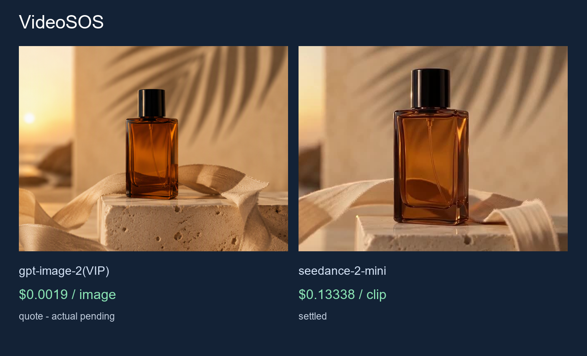

# Более доступные изображения и видео для VideoSOS

Проверены независимые вызовы ToAPIs для изображения и видео с первым кадром. Это оригинальные API-файлы, а не скриншоты работы VideoSOS. Нативный Rust/Tauri-провайдер, хранение ключа и импорт на timeline пока не приняты. В текущем исходном enum зарегистрированы OpenRouter, fal и Runware; замена Base URL недостаточна.

[English: full guide](README.md) · [API parameters and prices](PRICING.md)



# Corresponding API pricing

| Model | Parameters | API price | This case |
|---|---|---|---|
| gpt-image-2(VIP) | n=1, size=1:1, resolution=1K, quality=low | $0.0019/image | $0.0019 quote; actual pending |
| seedance-2-mini | duration=4, resolution=480p, aspect_ratio=16:9, generate_audio=False | $3.285714/M tokens | $0.13338 settled; MP4 4.04s; $0.033015/s observed |

Rates queried with the generation API Key on 2026-10-22. Quotes are not settled charges. For token-metered video, $/M is the billing rate; observed $/s = this case’s settled cost / decoded MP4 duration and is not a fixed future price. gpt-image-2(VIP) low/1K starts at $0.0019/image. No comparative quality, uptime or savings benchmark is claimed.


## Проверка

1. Задайте TOAPIS_API_KEY приватно.
2. Сначала запросите цену, без --live.
3. Только после проверки добавьте --live и стабильный --run-id.
4. Повторный запуск с теми же данными продолжает сохранённую задачу.
5. После завершения сохраняется PNG/MP4; неизвестное списание не равно нулю.

```sh
python unified_client.py --model gpt-image-2-vip --prompt-file prompts/image.txt --max-usd .10
# Add --live --run-id reviewed-case only for a paid request
```

[Provider details](integration/README.md)

[ToAPIs](https://go2v.toapis.com/1022_vs) · 1022_vs
